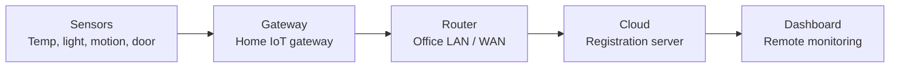

# Smart Home / Office IoT System with Cloud Monitoring

> **DRAFT — to be finalised later.**
> This Markdown file is the editable source of truth. The original HTML is kept
> unchanged in [`_archive/Project_Proposal.html`](./_archive/Project_Proposal.html).
> Fields marked `[TBD]` must be completed before submission
> (see [Finalisation checklist](#finalisation-checklist)).

## Cover details

| Field | Value |
|---|---|
| Student Name | [TBD] |
| Student ID | [TBD] |
| Programme | Certificate IV in Information Technology |
| Module | Module 9 — Emerging Technologies (13 Credits) |
| Lecturer | [TBD] |
| Submission Date | [TBD] |
| Assessment | Project (Course Assessment) |

## 1. Introduction

Homes and small offices increasingly use connected sensors to monitor conditions
such as temperature, light, motion, and door access. These devices form part of
the Internet of Things (IoT), where physical objects collect data and send it to
a network or cloud service for monitoring and control. This project will design,
build, and test a proof-of-concept smart home/office system that monitors several
sensors and reports the readings to a central cloud server, allowing a user to
view the data remotely.

The project is developed entirely in simulation using **Cisco Packet Tracer**,
supported by free cloud tools. No additional hardware will be purchased for this
project, so there is no delay from ordering and shipping equipment. This allows
the full design to be completed and tested within the assessment period. Physical
hardware is documented as future work.

## 2. Problem statement

Small offices and homes often have no affordable way to remotely monitor basic
conditions such as temperature, light, or whether a door is open. Manual checking
requires staff to be physically present and delays response to problems. A
low-cost networked monitoring system can provide remote visibility, but such a
system must be designed carefully so that devices, the network, and the cloud
link are simple, reliable, and reasonably secure.

## 3. Aim

To design, simulate, and test a working proof-of-concept IoT system that collects
sensor data, transmits it through a home/office gateway to a cloud service, and
displays it remotely, demonstrating the fundamentals of computer architecture,
cloud computing, and the Internet of Things.

## 4. Objectives

1. Design a network topology connecting at least **four simulated IoT devices**
   (temperature, light, motion, door sensor) to a home gateway.
2. Configure the gateway, router, and cloud/registration server so device
   readings are transmitted and received correctly.
3. Display live sensor readings on a remote dashboard and demonstrate remote
   control of at least **one actuator** (for example, a light or fan) using
   threshold rules.
4. Apply basic security measures (passwords, access control lists, secure
   registration) and describe their purpose.
5. Test the system using at least **six test cases** and record the results.
6. Produce a project report, architecture diagram, demonstration video, and a
   future-work plan for physical implementation.

## 5. Scope

### Included in this project
- Simulated smart home/office environment with sensors and one actuator.
- Home gateway, LAN, and cloud connection using Cisco Packet Tracer IoT features.
- Remote monitoring and basic control through a cloud/registration server.
- Basic security configuration and a simple security discussion.
- Testing, documentation, and demonstration.

### Not included (future work)
- Purchase and wiring of physical sensors, controller boards, and power supplies.
- Mobile application development and production-level cloud hosting.
- Advanced analytics, machine learning, or large-scale deployment.

> **Note:** All devices are simulated. The proposal avoids any additional
> hardware cost, which keeps the project on schedule. A physical build is
> proposed in [Section 11](#11-future-work-and-estimated-hardware) as future work.

## 6. Proposed solution

The system follows a three-layer IoT model. In the **device layer**, sensors
measure physical conditions and send data to a home gateway. In the **network
layer**, the gateway forwards data through the office router to the internet. In
the **cloud layer**, a registration server stores the data and provides a
dashboard for remote monitoring and control. This maps directly to the
machine-to-gateway (M2G) and machine-to-cloud (M2C) connection types.

*Figure 1: Proposed system architecture (proof of concept).*

## 7. Tools and technologies

| Tool / Technology | Purpose | Cost |
|---|---|---|
| Cisco Packet Tracer | Network and IoT device simulation | Free (student) |
| Packet Tracer IoT Server | Cloud registration and remote dashboard | Free |
| Free cloud dashboard (optional) | Charting simulated data (e.g. ThingSpeak) | Free tier |
| Python (optional) | Simple data simulation and cleaning script | Free |
| Word / PowerPoint | Report and presentation | Available |

## 8. Competency mapping

| Competency | How the project covers it |
|---|---|
| **C25** | Computer architecture and operating systems: comparing device/OS options for IoT nodes and gateways (e.g. Raspberry Pi OS, Ubuntu Core, RIOT); understanding how system components fit together. |
| **C26** | Cloud computing: cloud service types, cloud vs fog model, connecting devices to a cloud platform, data acquisition and storage, and basic cloud security concerns. |
| **C27** | IoT and AI fundamentals: controlled system, sensors and actuators; OSI/TCP-IP layers; copper and wireless media; M2G and M2C connections; WiFi/ZigBee use; metadata, privacy, and IoT security challenges. |

## 9. Implementation plan

| Week | Activity | Deliverable |
|---|---|---|
| 1 | Finalise proposal, aims and objectives, and draw the architecture diagram. | Approved proposal |
| 2 | Build base network in Packet Tracer: PCs, router, switch, gateway, and IP addressing plan. | Base topology file |
| 3 | Add sensors and actuator; configure the IoT gateway and device registration. | Working sensor readings |
| 4 | Connect to the cloud/registration server and set up remote monitoring. | Remote dashboard working |
| 5 | Add threshold alerts and remote actuator control; apply basic security settings. | Alert and control demo |
| 6 | Optional extra: simulated data pipeline and chart on a free cloud dashboard. | Data chart |
| 7 | Run test cases, fix problems, capture screenshots, and record a demonstration video. | Test results table |
| 8 | Write final report and prepare presentation. | Report and slides |

## 10. Testing plan

| No. | Test | Expected result |
|---|---|---|
| 1 | Temperature sensor changes value | New reading updates on dashboard |
| 2 | Door sensor opened | Status changes and alert is shown |
| 3 | Motion detected | Motion event recorded and displayed |
| 4 | Actuator switched on remotely | Device state changes in simulation |
| 5 | Device disconnected from network | Dashboard shows device as offline |
| 6 | Unauthorised device tries to register | Registration is rejected |
| 7 | Cloud server unavailable | Gateway buffers/retries and recovers |
| 8 | Threshold rule triggered | Correct alert or actuator action occurs |

## 11. Future work and estimated hardware

The simulation validates the design, but a physical build would prove the system
in a real environment. The following components are proposed for later
implementation. Prices are indicative only and will be confirmed at the time of
purchase.

| Component | Purpose | Est. cost | Status |
|---|---|---|---|
| ESP32 development board | Main controller for sensors | Low | Future work |
| DHT22 sensor | Temperature and humidity | Low | Future work |
| PIR motion sensor | Motion detection | Low | Future work |
| LDR module | Light level detection | Low | Future work |
| Reed switch / door sensor | Door open/closed detection | Low | Future work |
| Relay module | Actuator control | Low | Future work |
| Raspberry Pi (optional) | Physical gateway / local server | Medium | Future work |
| Power supply, wires, case | Deployment and safety | Low | Future work |

Expected challenges for the physical build include sensor calibration, stable
power supply, and reliable wireless coverage. These will be addressed during the
future implementation phase.

> `[TBD]` — replace "Low/Medium" with confirmed prices before submission.

## 12. Expected deliverables

1. Packet Tracer project file (`.pkt`) with the completed topology.
2. Architecture and network diagrams.
3. Test plan and results table with screenshots.
4. Short demonstration video (5–10 minutes).
5. Final project report.
6. Presentation slides.

## 13. Risks and mitigation

| Risk | Mitigation |
|---|---|
| Simulation features limited or unstable | Use standard Packet Tracer IoT devices; keep the design simple; save versions regularly. |
| Cloud/dashboard access issues | Use the built-in Packet Tracer IoT server; optional free cloud tool as backup. |
| Time lost to configuration errors | Follow the weekly plan; keep a working backup copy of the `.pkt` file. |
| No physical hardware | Document as future work with a clear component list and estimated costs. |

## 14. Conclusion

This project will deliver a clear, low-cost proof of concept of a smart
home/office IoT system using simulation and free cloud tools. It demonstrates the
core ideas of all three competencies — computer architecture and operating
systems, cloud computing, and the Internet of Things — while remaining achievable
for a Certificate IV student within eight weeks. Physical hardware implementation
is planned as future work, so the project can be completed on schedule without
waiting for purchased components.

## Finalisation checklist

Tick each item before submission. Update `status: draft` to `status: final` and
set `finalise_by` in the front matter when done.

- [ ] Student name and ID entered
- [ ] Lecturer name entered
- [ ] Submission date confirmed
- [ ] Architecture diagram redrawn/exported as an image (if required by the brief)
- [ ] Hardware costs confirmed and currency added
- [ ] Test cases expanded to the required minimum with evidence placeholders
- [ ] Packet Tracer topology file attached or linked
- [ ] Demonstration video recorded
- [ ] Report and slides drafted
- [ ] Instructor review completed
- [ ] Front matter updated to `status: final`

## Related documents

- [LMS proposal](../LMS-PROPOSAL.md)
- [C25 outline](../syllabus/C25-architecture-os.md)
- [C26 outline](../syllabus/C26-cloud-computing.md)
- [C27 outline](../syllabus/C27-iot-ai.md)
- [Roadmap](../implementation/ROADMAP.md)
